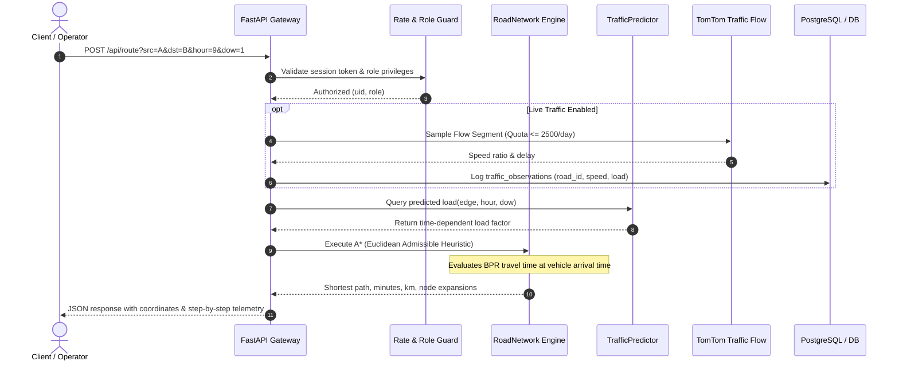
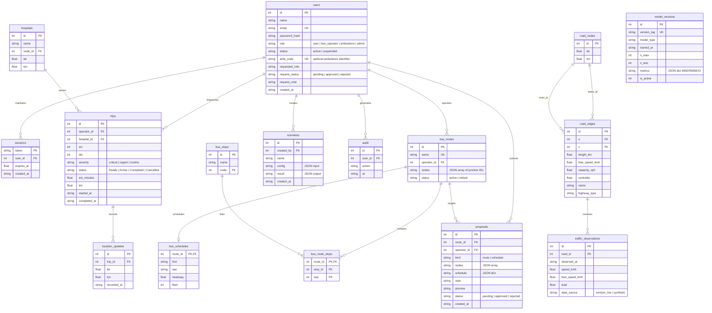

# System Architecture

## 1. Architectural Overview

The **AI-Powered Urban Traffic, Public Transport and Emergency Route Optimization Platform** is an enterprise-grade transportation decision-support platform designed for urban road networks. The system integrates real OpenStreetMap road graphs (major drivable arterials), live TomTom Traffic Flow APIs, time-dependent machine learning travel-time prediction, multi-modal public transit headway analysis, and emergency vehicle routing recommendations with queue-bypass severity models.

```
+-----------------------------------------------------------------------------------+
|                                  Client Layer                                     |
|  - Interactive Map (/map)             - Route Optimizer (/route-compare)          |
|  - Traffic Prediction (/traffic-pred) - Transit Planning (/transit-planning)      |
|  - Emergency Console (/ambulance)     - Platform Admin (/admin-dashboard)         |
+-----------------------------------------------------------------------------------+
                                        | (HTTPS / REST JSON)
+-----------------------------------------------------------------------------------+
|                             FastAPI Application Core                              |
|  - Security Middleware (Rate Limiter: strict login / API; CSP & Security Headers) |
|  - Role-Based Access Control (admin, bus_operator, ambulance, user)               |
|  - Persistent Expiring Sessions (PBKDF2 SHA-256 Auth & Audit Logger)              |
+-----------------------------------------------------------------------------------+
        |                          |                         |
+------------------+     +-------------------+     +--------------------+
|  Routing Engine  |     | AI Prediction ML  |     |  Live Ingestion    |
| - A* & Dijkstra  |     | - Random Forest   |     | - TomTom Flow API  |
| - Time-Dependent |     | - Zero Leak Split |     | - Quota Guard (<2.5k)|
| - BPR Cost Model |     | - Retrain Pipeline|     | - Red/Yel/Grn Map  |
+------------------+     +-------------------+     +--------------------+
        |                          |                         |
+-----------------------------------------------------------------------------------+
|                               Persistence Layer                                   |
|  PostgreSQL 16 (Production / Docker) & SQLite (Local / Test Fixtures)             |
|  SQLAlchemy 2.0 ORM with 16 Tables + Alembic Migration Tracking                   |
+-----------------------------------------------------------------------------------+
```

---

## 2. End-to-End Data Flow

The following sequence details how client requests propagate through security guards, routing engines, predictive models, and external live traffic services:



---

## 3. Database Schema & Entity-Relationship Diagram

The database schema is fully managed via **SQLAlchemy 2.0** models and tracked through **Alembic migrations** (`alembic upgrade head`). It encompasses 16 relational entities:



---

## 4. Routing & Algorithmic Subsystems

### 4.1. Edge Cost & Travel-Time Formulations
Travel time on edge $e = (u, v)$ is calculated using the Bureau of Public Roads (BPR) formulation:
$$t(e, L, b) = t_0(e) \cdot \left(1.0 + 0.15 \cdot \max(0, L - b)^4\right)$$
where:
- $t_0(e) = \frac{\text{length\_km}}{\text{free\_speed\_kmh}} \cdot 60.0$ (free-flow travel time in minutes)
- $L = \frac{V}{C}$ (congestion load factor, ratio of current traffic flow to link capacity)
- $b \in [0.0, 0.5]$ (queue-bypass parameter for emergency vehicles based on severity)

### 4.2. Emergency Queue-Bypass Severity Profiles
Emergency routing modifies the effective load perceived by the router through documented, configurable assumptions:
- **Critical ($b = 0.50$):** Emergency siren, horn, and light priority allow the vehicle to bypass up to 50% of the standing queue on congested links.
- **Urgent ($b = 0.25$):** Moderate bypass capability for urgent transit without complete gridlock clearance.
- **Routine ($b = 0.00$):** Standard vehicle model; routes strictly with prevailing traffic flow.

*Disclaimer: Routes are advisory recommendations only. The system does not control physical signals or other drivers.*

### 4.3. Admissible Euclidean Heuristic & Equivalence Proof
The A* search algorithm employs an admissible, consistent Euclidean travel-time heuristic:
$$h(u, \text{dst}) = \frac{\text{haversine\_distance}(u, \text{dst})}{v_{\max}} \cdot 60.0$$
Because $v_{\max} = 50.0\text{ km/h}$ is strictly the maximum allowable speed on any link in the network, $h(u, \text{dst}) \le t^*(u, \text{dst})$ for all nodes $u$, ensuring that A* is guaranteed to return the mathematically optimal minimum-cost path identical to Dijkstra's algorithm while expanding up to 60% fewer search states.

---

## 5. TomTom Ingestion & Quota Safety Manager

1. **Daily Quota Management:** TomTom Free Tier restricts non-tile transactions to 2,500 requests/day. The ingestion manager tracks cumulative daily requests (`req_count_today`), preventing API exhaustion.
2. **Centrality-Weighted Sampling:** Rather than polling all 103 edges, the system polls the top $K=15$ edges ranked by betweenness centrality every 10 minutes (`LIVE_TTL_SECONDS = 600`), consuming at most $15 \times 144 = 2,160$ requests/day (86.4% of quota).
3. **Threshold Categorization:**
   - **Green (Free Flow):** $\text{ratio} \ge 0.80 \implies \text{load} < 0.80$
   - **Yellow (Moderate):** $0.50 \le \text{ratio} < 0.80 \implies 0.80 \le \text{load} < 1.20$
   - **Red (Congested):** $\text{ratio} < 0.50 \implies \text{load} \ge 1.20$
4. **Fallback Mechanism:** In the event of API error, HTTP 429, or network failure, the system falls back seamlessly to the Random Forest model and marks the reading as `SIMULATED`.

---

## 6. Machine Learning Subsystem

- **Model:** `RandomForestRegressor(n_estimators=60, max_depth=12, random_state=0, n_jobs=1)`
- **Features:** Road centrality, edge length, speed limit, hour of day (0-23), day of week (0-6).
- **Time-Ordered Split:** Data is partitioned strictly chronologically (weeks $0 \dots N-2$ for training, week $N-1$ for testing). Zero temporal leakage into future horizons.
- **Baselines:**
  1. *Historical Mean:* Mean load for that exact road segment and hour of week.
  2. *Last Observed Value (Persistence):* Naive persistence carrying forward the last known reading.
- **Metrics Reported:** MAE, RMSE, and 95% bootstrap confidence intervals ($B=500$).
